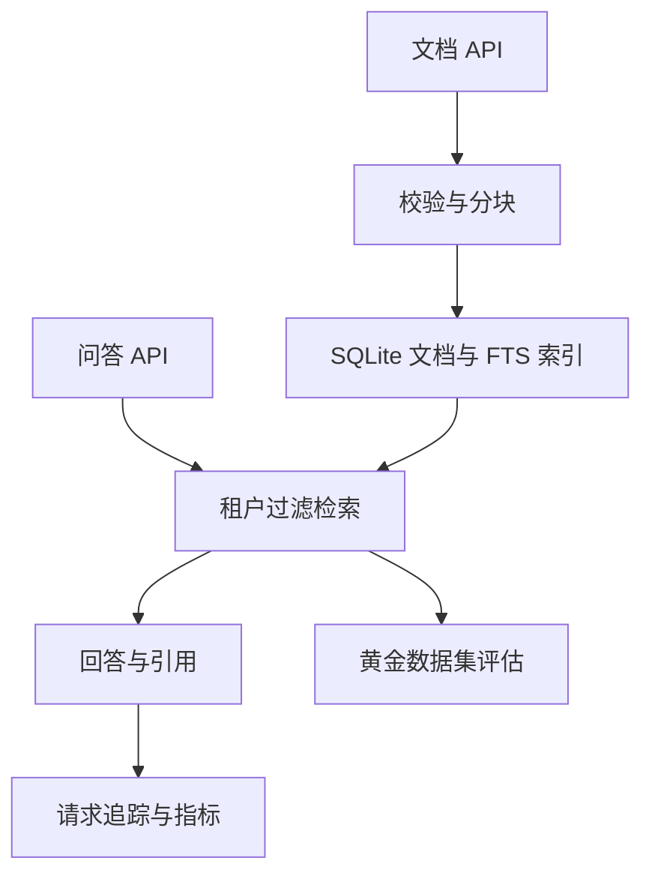

# 架构与验收边界

## MVP 已有能力

| 领域 | 实现 | 可验证证据 |
| --- | --- | --- |
| 入库 | 文本/Markdown 内容、600 字分块、80 字重叠；同租户同标题按内容哈希幂等更新 | 更新旧词不再命中、重复提交无改动的测试 |
| 检索 | FTS5/BM25、英文词和中文双字、租户过滤、引用文档 ID | 中文检索、跨租户隔离测试 |
| 回答 | 默认证据句提取；可配置兼容 Chat Completions 的模型；无证据明确拒答 | 引用测试、演示输出 |
| 评估 | 人工标注的期望文档，Recall@k、MRR@k、答案关键词覆盖率、引用率 | `/evaluate` 与离线演示 |
| 可观测 | 问答/入库延迟、错误分类、命中数、trace ID、近 1000 条聚合 | `/metrics` 与追踪测试 |
| 可靠性 | SQLite 事务、WAL、幂等更新、大小上限、模型超时与错误返回 | 自动化测试与接口行为 |

## 生产化路线及验收

1. 身份与权限：用 OIDC/JWT 验证身份，从可信身份映射租户，加入文档级 ACL。当前共享 API key 加自报租户仅适合单组织隔离演示，不能对不可信客户端开放。
2. 摄取：异步任务队列、对象存储、PDF/DOCX 解析、恶意文件检查、版本与删除同步；用故障注入验证重试、死信和可恢复性。
3. 检索：向量索引、混合召回、重排、权限过滤先于召回；对固定数据集测 Recall@k、MRR、nDCG、分语言与文档类型切片。
4. 生成评估：答案正确性、忠实度、拒答、引用准确性建立人工标注集；自动判分经人工抽样校准，不将引用存在率等同于忠实度。
5. 可观测：接 OpenTelemetry/Langfuse；分阶段延迟、token/费用、模型超时、检索空结果率、队列堆积和告警；配置脱敏与保留期。
6. 压测与部署：PostgreSQL/向量库、迁移、备份恢复、限流、并发压测、CI 与容器部署；明确 SLO 并用压测结果说明容量。

## 面试演示顺序

先运行离线演示并展示引用、检索指标；修改文档后重复提问说明索引一致性；用两个租户重复问题展示隔离；最后展示失败边界和生产化验收项。
